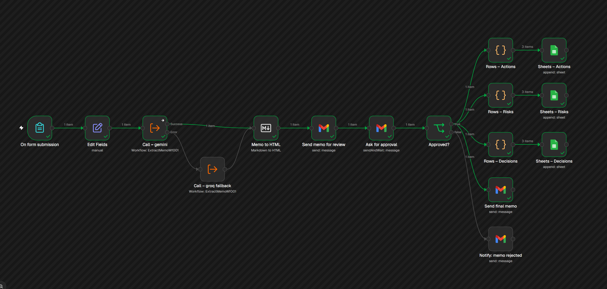

# Workshop-to-Decision: an AI-assisted workflow from meeting notes to agreed decisions

> **Fictional company, illustrative data.** All workshops, people and figures are invented
> (Aurora Beauty Group, banners Aurora and Lumi). No real company data is used.



## The problem
After every workshop, someone has to turn pages of notes into a clear list: what was decided, who does
what, and what could go wrong. That can easily take 30 minutes to an hour per meeting, and it's easy to
get wrong. A question that was only discussed gets written down as decided, and a task nobody took on
quietly disappears.

## What it does
- **Turns raw meeting notes into structure:** paste notes from any meeting, in English or a Nordic
  language. The AI pulls out the decisions, open questions, tasks with owners, risks and dependencies.
- **Drafts a one-page summary for the leadership group**, with short warning notes such as
  "2 tasks have no owner" or "3 open questions need an answer".
- **Keeps a manager in charge:** the decision owner approves or rejects the summary by email. Only
  approved content is sent on and saved to a shared action, risk and decision tracker (Google Sheets).

## Why a manager signs off
The AI writes the draft; people make the decisions. The approval step keeps decision rights and
accountability with people, and catches the AI's mistakes before they spread.

## How it's built
```
Form ─▶ Extract & Memo (shared sub-workflow) ─▶ Review email ─▶ Approve / Reject ─▶ Sheets + final memo
          │  Gemini 3.1 Flash-Lite by default
          └─ Groq gpt-oss-120b takes over automatically if Gemini fails
Eval webhook ─▶ same sub-workflow ─▶ Python scoring against hand-written answer keys
```

- **n8n 2.45.5**, self-hosted in Docker, runs four workflows: a shared `Extract & Memo` sub-workflow,
  the main `Workshop to Decision` flow, an `Eval – Extract` webhook and an error handler.
- **One shared sub-workflow:** the demo, the backup AI and the evaluation all run the same prompts and
  code, so the scores measure what the demo actually does.
- **Two AI services:** Gemini is the default; if it doesn't answer, Groq takes over automatically and
  the tracker records which one wrote each summary.
- **Python** runs both models on four test meetings and scores them against answer keys.

## Model evaluation
I wrote four fictional workshops with deliberate traps (a question discussed but not decided, tasks
nobody took on, a facilitator summary that leaves things out, an owner who hands a task back), one of
them in **Danish**, plus an answer key for each. Both models ran on all four through the real workflow,
and a script scored their output. I also scored each summary by hand for accuracy, clarity,
actionability and concision.

| Metric | Weight | Gemini 3.1 Flash-Lite | Groq gpt-oss-120b |
|---|---|---|---|
| Decisions found (F1) | 25% | 79% | 27% |
| Open questions NOT passed off as decisions | 20% | 88% | 50% |
| Tasks found (F1) | 15% | 78% | 36% |
| Owner accuracy (no invented owners) | 15% | 100% | 45% |
| Risks found (recall) | 10% | 35% | 21% |
| Dependencies found (recall) | 5% | 83% | 38% |
| Valid output structure | 5% | 100% | 50% |
| Summary quality (hand-scored) | 5% | 89% | 36% |
| **Overall score** | | **8.1 / 10** | **3.7 / 10** |
| Overall, successful runs only | | 8.1 (4 of 4) | 7.4 (2 of 4) |
| Average response time | | 48.6 s | 10.2 s |
| Failed runs | | 0 | 2 |

**Conclusion.** Gemini is the default because it was better on both **quality** and **reliability**.
Groq's overall score is pulled down by two runs that failed on its free-tier limits; comparing only
the runs that completed, the gap is smaller (8.1 vs 7.4). Groq is about five times faster, but its
summaries were roughly twice as long and added opinions that weren't in the notes (for example,
recommending a pilot market the group had deliberately left open). For a tool whose job is to record
what was actually agreed, that matters more than speed.

**The most common mistakes**, which are the target of the next prompt improvement:
- listing tasks or meeting dates as decisions
- recording an unowned task as an open question instead of flagging it as "unassigned"
- calling the workshop "the steering committee"

Full results: [`eval/results/scorecard.md`](eval/results/scorecard.md) ·
per-item matches: [`eval/results/match_review.csv`](eval/results/match_review.csv) ·
hand scores: [`eval/memo_rubric.csv`](eval/memo_rubric.csv)

## Rollout & adoption
Building the tool is the easy part; getting people to use it well is the hard part.
[`docs/rollout_adoption_plan.md`](docs/rollout_adoption_plan.md) sets out who does what and who decides
what, the rules of use, a pilot in one team, how adoption is measured and the main change risks.

## Trade-offs

**This tool compared with Microsoft Copilot in Teams** (which can already summarise Teams meetings):

| This tool | Microsoft Copilot in Teams |
|---|---|
| ✅ Our own rules for what counts as a decision | ✅ Already built into Teams and Outlook |
| ✅ A manager signs off before anything is shared | ✅ Microsoft's security and IT controls built in |
| ✅ Works with notes from any meeting | ✅ Nothing to build or maintain |
| ✅ Tested against correct answers | ✅ Works live, during the meeting |
| ✅ Pay per use, not a licence per person | ❌ Its rules and format can't be changed |
| ❌ Needs building, maintaining and a security review | ❌ No sign-off step; Teams meetings only |

In a real company I'd weigh these up. The same rules and sign-off step could also be built on top of Copilot.

**Choices inside this project:**
- **Free AI services:** €0 cost, but lower limits and less control. Free tiers also change without
  warning: during the project, the newest Gemini Flash model was capped at 20 requests a day and often
  overloaded, and Gemini 2.5 Flash was closed to new users. I chose **Gemini 3.1 Flash-Lite**, which
  was available and reliable, and the tests showed its quality was good enough.
- **Approve or reject only:** simple, but managers can't correct a line or give a reason.
- **Automatic scoring with approximate text matching:** fast and repeatable; matches checked by hand.
- **Four test meetings:** enough to compare models, not to prove accuracy.

Because the testing is automatic, a stronger paid model can be tried and measured, so any extra cost is
decided by results rather than guesswork.

## What I'd improve next
1. **Smarter:** tell decisions and tasks apart better (prompt v2, then re-score); test on many more meetings
2. **More control:** let managers correct the draft, and say why when they reject it
3. **Ready for real company data:** a paid AI service that keeps data in Europe, and a privacy review
4. **Easier to use:** take notes straight from Teams; write the summary in the team's own language
5. **Follow-up:** remind people about late tasks; show which team is waiting on another

## How to run it
1. Start n8n in Docker:
   ```bash
   docker volume create n8n_data
   docker run -it --rm --name n8n -p 5678:5678 -e GENERIC_TIMEZONE="Europe/Copenhagen" \
     -v n8n_data:/home/node/.n8n docker.n8n.io/n8nio/n8n:2.45.5
   ```
2. Open `http://localhost:5678` and add credentials for **Google Gemini**, **Groq**, **Google Sheets**
   and **Gmail**.
3. Import the four workflows from the command line (this keeps their fixed IDs, so they find each other):
   ```bash
   docker cp workflow/exports n8n:/tmp/exports
   docker exec -u node n8n n8n import:workflow --separate --input=/tmp/exports
   ```
   Attach your credentials, set your Google Sheet ID (tabs `Actions`, `Risks`, `Decisions`), then
   publish `Extract & Memo`, `Eval – Extract` and `Workshop to Decision`, in that order
   (n8n 2.x only runs published sub-workflows).
4. Run the evaluation:
   ```bash
   python -m venv .venv && source .venv/bin/activate   # Windows: .venv\Scripts\activate
   pip install -r eval/requirements.txt
   python eval/run_eval.py          # or: python eval/run_eval.py gemini
   python eval/score_models.py
   ```

To change a prompt, edit the files in `prompts/`, run `python workflow/build_workflows.py`, and re-import.

## Repository layout
```
workflow/   build_workflows.py + exports/ (sub-workflow, main, eval webhook, error handler)
prompts/    extraction prompt, memo prompt, output schema (the single source of truth)
samples/    four fictional workshops (one in Danish), answer keys, notes on the traps in each
eval/       run_eval.py, score_models.py, hand scores, model outputs and results
docs/       rollout & adoption plan, screenshots
```

## Limitations
- **Fictional data only.** Free AI tiers may use prompts to improve their products. Real use would need
  a data-processing agreement, EU data residency and a GDPR review.
- **Scoring is approximate:** answer-key items are matched to model output by text similarity, and the
  matches are checked by hand.
- **Small test set:** four meetings, one run each. Enough to compare models and spot typical errors,
  not to prove accuracy.
- **Local hosting:** the approval links point to `localhost`, so approvals happen on the machine running n8n.
